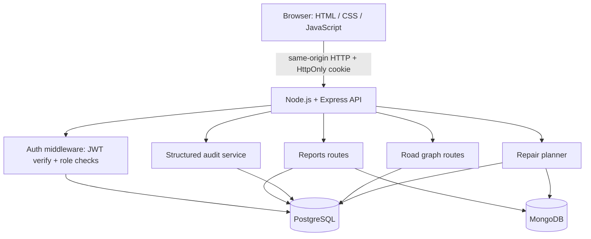

# CivicFix Architecture

## Problem statement

Civic teams receive more issue reports than they can repair immediately. They need a way to triage reports, understand which locations are reachable on the road network, and choose a repair set that fits a fixed budget.

CivicFix is an educational decision-support prototype with fictional seeded data. It is not a municipal service and its urgency weights are illustrative, not validated public-safety policy.

## High-level architecture



## Responsibility by component

| Component | Responsibility |
|---|---|
| `public/` | Responsive UI, report board, SVG road-network view and browser API client |
| `src/routes/auth.js` | Registration, login, logout and current-user endpoint |
| `src/middleware/auth.js` | Optional identity, required login and admin role guard |
| `src/routes/reports.js` | Public report list, signed-in report submission and admin status updates |
| `src/routes/graph.js` | Fetch road graph and admin road-closure changes |
| `src/routes/planning.js` | Budget-based repair selection and route planning API |
| `src/services/graph.js` | Adjacency-list graph, min-priority queue and Dijkstra |
| `src/services/optimizer.js` | Urgency score and 0/1 knapsack DP |
| `src/services/routePlanner.js` | Exact Held–Karp stop ordering up to 12 stops; nearest-neighbour fallback above the cap |
| `src/db/schema.sql` | Relational schema for users, crews, nodes, edges and planning history |
| `src/db/mongo.js` | MongoDB connection and indexes for reports |
| `src/db/postgres.js` | PostgreSQL connection pool |

## Data ownership

- **PostgreSQL:** users and password hashes, crews, graph nodes/edges, saved planning history, and structured audit events.
- **MongoDB:** variable-shaped civic issue reports and their status/history fields.
- **Browser:** transient UI state. Session identity is held in an HttpOnly cookie, not localStorage.

## Request flows

### Registration / login

1. Browser sends email and password to `POST /api/auth/register` or `POST /api/auth/login`.
2. Server validates input and verifies/stores the password using bcrypt.
3. Server signs an expiring JWT and sends it in a `HttpOnly; SameSite=Strict` cookie (Secure in production).
4. Protected routes verify the cookie and require authentication or the admin role.
5. Logout clears the cookie.

### Issue submission

1. Signed-in citizen submits title, description, category, location node, severity and estimated cost/time.
2. API validates fields and confirms the location node exists in PostgreSQL.
3. The report document is inserted into MongoDB, the source of truth for report content/status.
4. A structured audit event is separately written to PostgreSQL without report text, email, or password fields.
5. The UI refreshes the issue board from the API.

The report insert and PostgreSQL audit insert are not a distributed transaction. Audit persistence failures are logged and do not undo the already-committed report. A production service needing guaranteed audit delivery should add an outbox/reconciliation design rather than claim cross-store atomicity.

### Repair planning

1. Planner loads active issue reports and road-network data.
2. Dijkstra computes shortest paths while excluding closed roads.
3. Unreachable reports are excluded from the candidate set.
4. 0/1 knapsack selects a subset whose rounded-up repair costs stay under the configured budget.
5. Held–Karp bitmask DP orders up to 12 selected stops exactly using shortest-path distances. Larger stop sets use a reported nearest-neighbour heuristic.
6. The API returns selected repairs, costs, scores, route legs and the route method.

## Algorithm trade-offs

- **Dijkstra:** with a binary heap, typically `O((V + E) log V)`; appropriate because all road lengths are non-negative.
- **Two-constraint 0/1 knapsack:** `O(nBH)` time, where `B` is the budget in ₹1,000 units (capped at 5,000) and `H` is crew-hour capacity (1–80). Reconstruction decisions also use `O(nBH)` memory. Repair costs are rounded up to avoid exceeding the budget.
- **Held–Karp:** `O(2^k k^2)` time and `O(2^k k)` memory. It is exact for small `k), so the app caps exact ordering at 12 stops and discloses the heuristic fallback.
- **Current simplification:** urgency is based on severity plus a bounded age bonus. The DP constrains both estimated repair cost and one crew's available work hours. It does not optimise travel cost in the selection objective or enforce crew-specialty constraints, multiple-crew schedules or time windows.

## Security boundaries

- Passwords are stored as bcrypt hashes, not plaintext.
- Signed session JWT is in an HttpOnly cookie, inaccessible to ordinary browser JavaScript.
- Authentication routes are rate limited and Helmet adds security headers; bcrypt inputs are bounded to avoid accepting passwords through bcrypt's 72-byte truncation behaviour.
- Sessions expire after 30 minutes. Each authenticated request reloads the user's current role and token version from PostgreSQL, enabling immediate revocation after role/version changes.
- State-changing requests require a same-origin custom header and reject mismatched Origin hosts. Structured audit events are written to PostgreSQL; persistence failures are logged but do not roll back business data.
- Regular sign-up can only create a citizen account; admin-only endpoints have a separate role guard.
- Environment secrets must never be committed. Production must use fresh values for `JWT_SECRET`, `ADMIN_EMAIL`, and `ADMIN_PASSWORD`, plus least-privilege database credentials.
- This project is a learning prototype, not security-audited production software. Account recovery/email verification, independent review, moderation/privacy policy, backups/restore drills and monitoring remain outstanding before real public use.

## Verification

The Node test runner has two suites: algorithm/property tests that compare Dijkstra, knapsack and route ordering against reference implementations, plus an API integration suite that starts Express against disposable PostgreSQL and MongoDB databases. Integration coverage includes auth/session rules, overlong-password rejection, audit persistence, pagination, report persistence, role guards, road changes and planning/history. GitHub Actions runs both suites with PostgreSQL 16 and MongoDB 7 service containers.

Run with both databases and test environment variables configured:

```bash
npm ci
npm run db:seed
npm test
npm run test:integration
```

An on-demand live smoke workflow separately checks the deployed HTTP endpoints. Passing CI is not equivalent to verifying the public Render URL or completing a security audit.
